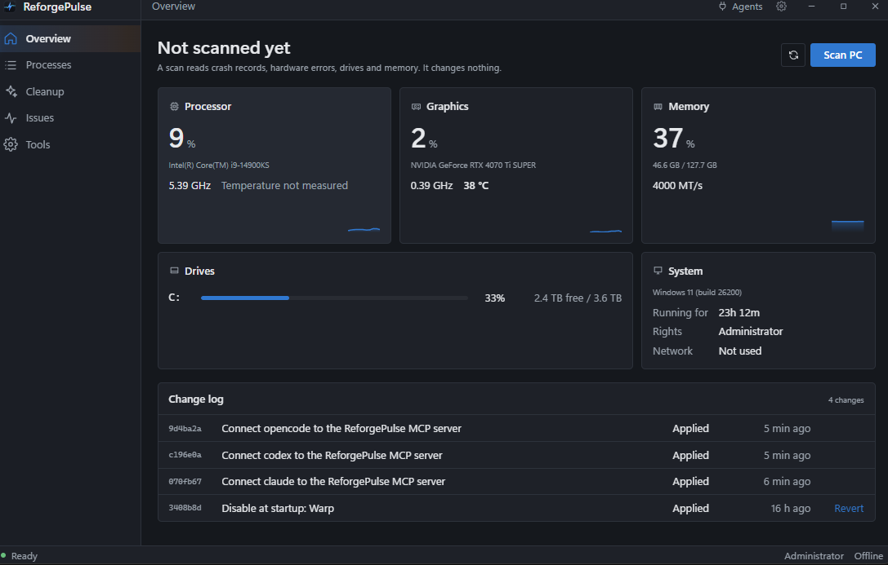

<p align="center"></p>

<h1 align="center">ReforgePulse</h1>

<p align="center"></p>

PC diagnostics and cleanup for the desktop, currently on Windows. It reads
what the system already records (event logs, WHEA, minidumps, counters,
sensors) to find why a PC crashes or slows down, and cleans up what it no
longer needs. Nothing is changed or deleted before it shows exactly what will
happen and you confirm it; every change then goes into a git-style change
log, with revert where the change can be undone. It runs elevated, and on
first start shows the terms and the licence to accept before anything else.

- **Issues**: Scan PC reads 30 days of stop errors (WER 1001), unexpected
  restarts (Kernel-Power 41), WHEA errors with their APIC IDs, display
  driver resets (4101), application and service failures, disk and NTFS
  errors, firmware throttling, microcode, tuning drivers (XTU, NTIOLib,
  WinRing0...) and devices without drivers. Findings have a severity and a
  confidence. On an unstable PC it weighs each suspect (CPU, memory, storage,
  heat, power, drivers, software) with the evidence for and against, and
  says "unmeasured" where Windows cannot see, rather than "fine". Every scan
  is saved as a report (the last 30 are kept) and findings new since the
  previous scan are marked. A finding marked resolved stays out of the way
  until an event newer than the mark turns up, then shows as "came back".
- **Cleanup**: temp, browser, app, developer and shader caches; Windows
  Update and WER leftovers; old logs; the Recycle Bin. Leftover folders of
  uninstalled programs in Program Files, ProgramData and AppData, matched
  against installed programs, services, startup entries and running
  processes. Downloads untouched for 180 days. Programs Prefetch says have
  not run in 90 days, removed by their own uninstaller. Startup apps with
  the memory they use now, disabled through `StartupApproved` like Task
  Manager does. Optional Windows features (SMB 1.0, PowerShell 2.0...).
  Leftovers and old downloads go to the Recycle Bin.
- **Processes**: a tree under parents, with CPU, GPU (per-process 3D engine
  share), private memory, TCP/UDP ports and "not responding". Search `:8080`
  for a port. End task refuses Windows' own processes.
- **Tools**
  - Hardware: board, BIOS, RAM sticks (rated vs configured speed),
    GPUs and drivers, disk health; every logical processor with its live
    effective clock (PDH `% Processor Performance`), P/E class and x2APIC ID
    from `CPUID`, so a WHEA "APIC 32" shows as LP 8, P-core 4.
  - Core test: runs deterministic SHA-256 and floating-point rounds on one
    pinned core at a time and compares results by majority vote.
  - Sensors: NVIDIA through `nvml.dll`; CPU temperatures and voltages from
    HWiNFO's shared memory (`HWiNFO_SENS_SM2`) when HWiNFO runs with Shared
    Memory Support. There is no driver of its own, so without HWiNFO the CPU
    temperature is not measured.
  - Events: System and Application, grouped by provider and ID with counts,
    messages through `EvtFormatMessage`, known noise (DCOM 10016...) hidden.
  - Minidumps: stop code and parameters from the `PAGEDU64` header;
    `!analyze -v` through cdb when WinDbg or the SDK debuggers are installed.
  - Recorder: load and per-process private bytes every 2 s; a linear fit
    flags steady growth as a likely leak.
  - Drivers: problem devices (ConfigManagerErrorCode) and what Windows
    Update offers, read through the Windows Update Agent. Installing is left
    to Windows Update and the makers' pages it links to.
  - Checks: `sfc /verifyonly`, `DISM /ScanHealth`, `chkdsk /scan`,
    Windows Memory Diagnostic.
  - CPU cap: `PROCFREQMAX` and `PROCFREQMAX1` on every power plan through
    `powrprof.dll`, old values kept for revert.
- **Reports**: saved scans (the last 30), crash dump analyses and recorder
  sessions (the last 20), to open again or delete.
- **History**: the change log, each entry deletable on its own or everything
  before a date; it keeps its last 500 entries. A revert entry is deleted
  with the change it undid, never alone, so a change can never look
  revertible twice.
- **Updates**: at start (unless turned off in Settings) and from Settings >
  Check for updates, ReforgePulse asks GitHub Releases for a newer version
  and asks before downloading it. The download is verified against the
  release's `SHA256SUMS`, logged in the change log, and swapped in when you
  restart.
- **MCP**: `reforgepulse.exe mcp` is a read-only MCP server over stdio,
  running unelevated. The MCP button registers it with Claude Code, Codex or
  OpenCode. Agents can scan and read; changes stay in the window.

Long work (scans, cleanup, checks, the core test) runs as tasks in the
status bar, at most four at a time, each cancellable. Reads that touch the
hardware directly (CPUID pinned to each processor, per-core counters, GPU
sensors, the core test) run in a `reforgepulse.exe probe` child process: if
one of them crashes, the child is restarted and the window stays open.

## Use

```
make run                # build bin/reforgepulse.exe and start it
make test               # go test -race ./internal/...
make vet                # go vet for GOOS=windows
make installer          # bin/reforgepulse-amd64-installer.exe (NSIS)
make release            # dist/: release assets and SHA256SUMS for the updater
make version V=1.2.3    # the version lives in build/config.yml only
```

To publish: `make version V=x.y.z`, `make release`, then a GitHub release
tagged `vx.y.z` with everything in `dist/`. The updater picks
`reforgepulse-windows-amd64.exe` and checks it against `SHA256SUMS`.

Builds from Windows or WSL with Go, Node and `wails3`. Windows is the only
platform implemented so far: OS access sits behind the interfaces in
`internal/platform`, so the rest of `internal/` builds and tests anywhere and
another OS is a new package next to `platform/windows`.

Data is in `%LOCALAPPDATA%\ReforgePulse`: `reforgepulse.db` (SQLite: the
change log, saved scans, resolved findings and settings, shared with the MCP
server), `reforgepulse.log` (errors, panics and crash reports, rotated at
1 MB), `webview/` and the debugger's `symbols/` cache. The network is used for two
things: the update check (GitHub Releases, at start unless turned off, and
from Settings) and that symbol download during a dump analysis.

## Layout

```
main.go, services.go   wiring: window, services, mcp mode, UAC relaunch
internal/
  domain       shared models
  platform     OS interfaces; windows/ implements them (Win32, PDH, WUA, NVML, wevtapi)
  inspect      read-only analysis: system, processes, startup, programs,
               leftovers, crashes, cores, events, dumps, features
  diagnosis    rules: evidence to findings and suspects
  cleanup      safe deletion in known locations
  coretest     the per-core stress test
  recorder     session recording and leak detection
  store        the SQLite database, its schema and the import of older files
  journal      the change log
  reports      saved scans and resolved findings
  consent      which wording of the terms was accepted
  tasks        bounded, cancellable background work for the status bar
  agents       registers the MCP server with agent CLIs
  mcp          the MCP server
  probe        the child process for hardware reads, and its client
  app          services the window and MCP call
frontend/src   Vue shell, Tailwind, one component per page and tab
```

What changed in each version is in [CHANGELOG.md](CHANGELOG.md).

ReforgePulse is free and open source under the [MIT License](LICENSE),
provided as is, without warranty. [TERMS.md](TERMS.md) says what that means
for a tool that runs as Administrator and changes your PC.
